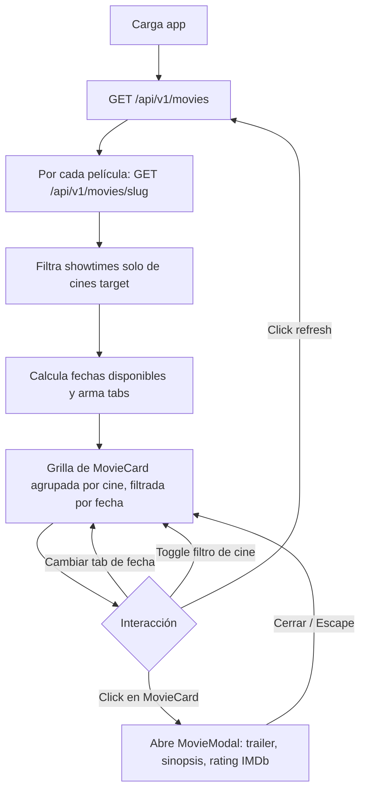
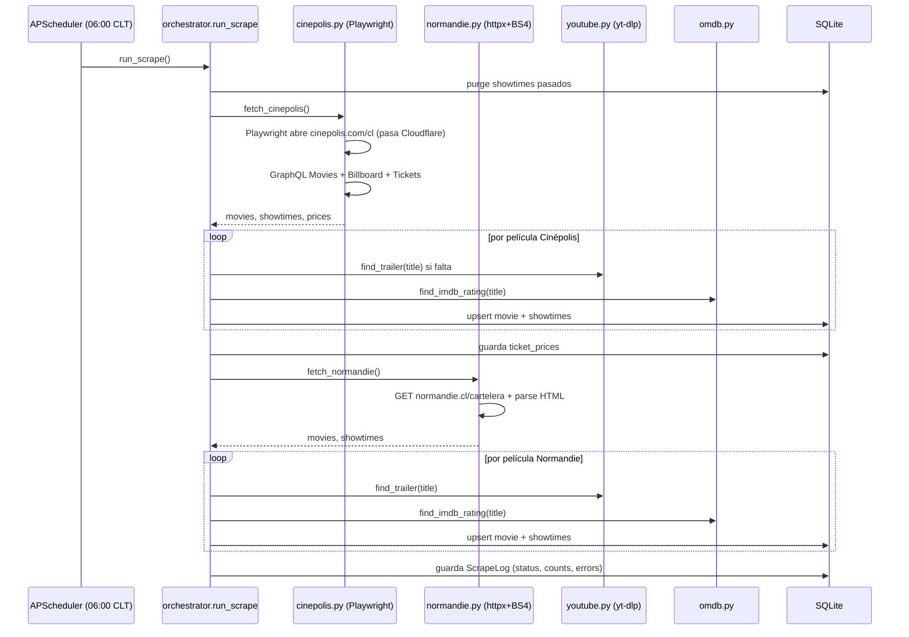

# Butaca (que-ver-cine-hoy)

API REST + frontend que hace scraping diario de la cartelera de cines de Santiago (Cinépolis Vivo Imperio, Cinépolis Estación Central y Cine Arte Normandie) y expone películas, horarios y precios de entradas a través de una webapp simple tipo "qué ver hoy".

## Stack técnico

**Backend**
- Python 3.10+, FastAPI
- SQLAlchemy 2.0 + SQLite
- `pydantic-settings` (config vía `.env`)
- APScheduler (cron diario 06:00 CLT)

**Scraping**
- Playwright (Chromium headless) — pasa Cloudflare bot-management de Cinépolis
- httpx + BeautifulSoup4 — Normandie (HTML server-rendered)
- yt-dlp — búsqueda de trailers en YouTube

**Frontend**
- Preact 10 + Vite 6, SPA de una sola vista (sin router)
- `vite-plugin-pwa`
- CSS plano

**Infra**
- Docker Compose (dev y prod)
- Traefik como reverse proxy con HTTPS (Let's Encrypt) en VPS
- Frontend deployado en GitHub Pages, VPS sirve solo la API
- Testing: pytest + pytest-asyncio

## Features

- Scrape diario automático (cron 06:00 CLT) + scrape al arranque si no hubo uno exitoso hoy + trigger manual admin
- Listado de cartelera: póster, título, clasificación de edad, duración, géneros, sinopsis
- Horarios agrupados por cine, fecha, idioma y formato (2D/3D/etc.)
- Precios de entradas por cine/formato/tipo de ticket (Cinépolis, vía Vista booking system)
- Rating IMDb opcional (OMDb API) con fallback a título original
- Trailer de YouTube embebido (búsqueda automática si el scraper no trae uno)
- Filtro de cartelera por fecha (tabs "Hoy"/"Mañana"/día) y por cine
- Modal de detalle de película con trailer embebido y sinopsis
- Indicador offline (banner "Sin conexión") y soporte PWA
- Botón de refresh manual en el header
- Endpoints de administración con auth por API key
- Purga automática de horarios de fechas pasadas en cada scrape
- Resiliencia: errores por película individual no abortan el scrape completo (`ScrapeLog` con status success/partial/failed)
- Reintentos con backoff en el scraper de Cinépolis (hasta 3 intentos)

## Estructura de carpetas

```
que-ver-cine-hoy/
├── src/
│   ├── main.py              # entrypoint FastAPI, lifespan (create_tables + scheduler)
│   ├── config.py            # Settings (pydantic-settings)
│   ├── api/
│   │   ├── router.py        # endpoints REST
│   │   └── schemas.py       # schemas Pydantic
│   ├── db/
│   │   ├── models.py        # Movie, Cinema, Showtime, TicketPrice, ScrapeLog
│   │   ├── engine.py        # engine SQLite + SessionLocal
│   │   └── migrations.py    # create_tables()
│   └── scraper/
│       ├── cinepolis.py     # Playwright + GraphQL
│       ├── normandie.py     # httpx + BeautifulSoup
│       ├── omdb.py          # rating IMDb
│       ├── youtube.py       # búsqueda de trailers
│       ├── orchestrator.py  # coordina pipeline, upsert, ScrapeLog
│       └── rate_limiter.py
├── frontend/
│   ├── src/
│   │   ├── App.jsx          # estado global, fetch, filtros date/cinema
│   │   ├── api.js           # fetchMovies, fetchMovieDetail
│   │   └── components/      # Header, DateTabs, CinemaFilter, MovieCard, MovieModal
│   └── public/, dist/
├── tests/
├── scripts/scrape_now.py    # trigger manual de scrape fuera del servidor
├── docs/                    # esta carpeta (RUNBOOK.md, README.md, API.md, LOG.md, FLOWS.html)
├── data/                    # SQLite db (volumen Docker)
├── docker-compose*.yml
└── pyproject.toml
```

## Diagramas

Ver [FLOWS.html](./FLOWS.html) para diagramas mermaid renderizados, o los bloques mermaid abajo.

### Flujo principal — usuario final (SPA)



### Flujo de scraping — backend (diario o manual)



Ver también [API.md](./API.md) y [LOG.md](./LOG.md).
